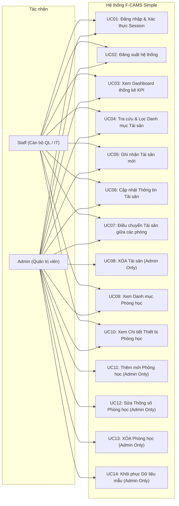
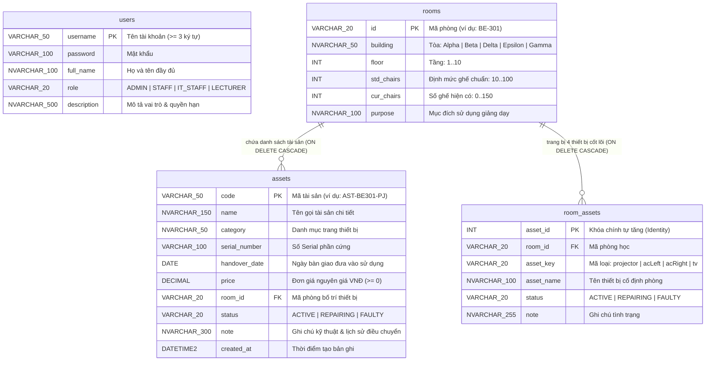

# TRƯỜNG ĐẠI HỌC FPT - FPT UNIVERSITY
## KHOA CÔNG NGHỆ THÔNG TIN
### MÔN HỌC: PRJ301 - LẬP TRÌNH ỨNG DỤNG JAVA WEB

---

# BẢN ĐẶC TẢ YÊU CẦU & THIẾT KẾ HỆ THỐNG
## HỆ THỐNG QUẢN LÝ TÀI SẢN PHÒNG HỌC (F-CAMS SIMPLE)
*(FPT Classroom Asset Management System)*

**Phiên bản:** 1.0  
**Nhóm thực hiện:** Đội ngũ phát triển F-CAMS - Nhóm 6  
**Lớp:** PRJ301 - SE / IA  
**Thời gian:** Tháng 10/2026  

| STT | Mã sinh viên | Họ và tên | Tỷ lệ đóng góp (%) |
| :---: | :---: | :--- | :---: |
| 1 | HE201049 | Bùi Văn Hậu | fontend |
| 2 | HE204696 | Bùi Văn Hoàng | backend |
| 3 | HE190003 | Lê Hoàng Nam | data |

---

## Mục lục
- [Mục lục](#mục-lục)
- [I. Tổng quan Hệ thống](#i-tổng-quan-hệ-thống)
  - [1. Yêu cầu Người dùng](#1-yêu-cầu-người-dùng)
    - [1.1 Tác nhân Hệ thống (Actors)](#11-tác-nhân-hệ-thống-actors)
    - [1.2 Danh sách Use Case](#12-danh-sách-use-case)
      - [a. Sơ đồ Use Case (Diagram)](#a-sơ-đồ-use-case-diagram)
      - [b. Bảng mô tả chi tiết Use Case](#b-bảng-mô-tả-chi-tiết-use-case)
  - [2. Chức năng Tổng quan](#2-chức-năng-tổng-quan)
    - [2.1 Sơ đồ Luồng màn hình (Screens Flow)](#21-sơ-đồ-luồng-màn-hình-screens-flow)
    - [2.2 Mô tả chức năng từng Màn hình](#22-mô-tả-chức-năng-từng-màn-hình)
    - [2.3 Ma trận Phân quyền Màn hình & Thao tác](#23-ma-trận-phân-quyền-màn-hình--thao-tác)
    - [2.4 Thiết kế Cơ sở Dữ liệu (Database Design)](#24-thiết-kế-cơ-sở-dữ-liệu-database-design)
      - [a. Sơ đồ Quan hệ Thực thể (ERD)](#a-sơ-đồ-quan-hệ-thực-thể-erd)
      - [b. Bảng đặc tả chi tiết CSDL](#b-bảng-đặc-tả-chi-tiết-csdl)
- [II. Đặc tả Thiết kế Chi tiết Màn hình](#ii-đặc-tả-thiết-kế-chi-tiết-màn-hình)
  - [1. Màn hình Đăng nhập (Login Screen)](#1-màn-hình-đăng-nhập-login-screen)
    - [1.1 Bộ điều khiển Web / Controller / Service](#11-bộ-điều-khiển-web--controller--service)
    - [1.2 Giao diện màn hình & Chi tiết các trường dữ liệu](#12-giao-diện-màn-hình--chi-tiết-các-trường-dữ-liệu)
  - [2. Màn hình Bảng điều khiển Thống kê (Dashboard Screen)](#2-màn-hình-bảng-điều-khiển-thống-kê-dashboard-screen)
    - [2.1 Bộ điều khiển Web / Controller / Service](#21-bộ-điều-khiển-web--controller--service)
    - [2.2 Giao diện màn hình & Chi tiết các trường dữ liệu](#22-giao-diện-màn-hình--chi-tiết-các-trường-dữ-liệu)
  - [3. Màn hình Quản lý Tài sản (Asset Management - CRUD)](#3-màn-hình-quản-lý-tài-sản-asset-management---crud)
    - [3.1 Bộ điều khiển Web / Controller / Service](#31-bộ-điều-khiển-web--controller--service)
    - [3.2 Giao diện màn hình & Chi tiết các trường dữ liệu](#32-giao-diện-màn-hình--chi-tiết-các-trường-dữ-liệu)
  - [4. Màn hình Quản lý Phòng học (Room Management - CRUD)](#4-màn-hình-quản-lý-phòng-học-room-management---crud)
    - [4.1 Bộ điều khiển Web / Controller / Service](#41-bộ-điều-khiển-web--controller--service)
    - [4.2 Giao diện màn hình & Chi tiết các trường dữ liệu](#42-giao-diện-màn-hình--chi-tiết-các-trường-dữ-liệu)
  - [5. Màn hình Chi tiết Phòng học & Thiết bị (Room Detail Screen)](#5-màn-hình-chi-tiết-phòng-học--thiết-bị-room-detail-screen)
    - [5.1 Bộ điều khiển Web / Controller / Service](#51-bộ-điều-khiển-web--controller--service)
    - [5.2 Giao diện màn hình & Chi tiết các trường dữ liệu](#52-giao-diện-màn-hình--chi-tiết-các-trường-dữ-liệu)

---

# I. Tổng quan Hệ thống
Hệ thống Quản lý Tài sản Phòng học Đại học FPT (**FPT Classroom Asset Management System - F-CAMS Simple**) là dự án ứng dụng web chuyên biệt phục vụ công tác quản lý tài sản, trang thiết bị giảng đường và cơ sở vật chất phòng học tại khuôn viên Trường Đại học FPT Hòa Lạc. Dự án được xây dựng dựa trên nền tảng công nghệ **Java 17 LTS, chuẩn Jakarta EE 10 (Servlet 6.0, JSP, JSTL 2.0, Thư viện thẻ tùy biến Custom JSP Tags)**, vận hành trên máy chủ web **Apache Tomcat 10.1** và hệ quản trị cơ sở dữ liệu **Microsoft SQL Server 2022** thông qua trình điều khiển Microsoft JDBC Driver.

Mục tiêu cốt lõi của F-CAMS Simple là tối ưu hóa và số hóa toàn diện quy trình kiểm kê của cán bộ quản lý và nhân viên kỹ thuật IT: theo dõi sức chứa chỗ ngồi thực tế so với định mức tiêu chuẩn, giám sát vòng đời trang thiết bị (máy chiếu, điều hòa, Smart TV, hệ thống âm thanh, máy trạm Lab CNTT/AI), phát hiện kịp thời các thiết bị hỏng hóc cần bảo trì khẩn cấp, và kiểm soát chặt chẽ việc điều chuyển tài sản qua lại giữa các phòng học thuộc các tòa nhà (`Alpha`, `Beta`, `Delta`, `Epsilon`, `Gamma`).

---

## 1. Yêu cầu Người dùng

### 1.1 Tác nhân Hệ thống (Actors)

| STT | Tác nhân (Actor) | Mô tả Quyền hạn & Trách nhiệm |
| :---: | :--- | :--- |
| **1** | **Admin (Quản trị viên)** | Quản trị viên hệ thống có quyền hạn cao nhất: Xem bảng điều khiển Dashboard KPI, toàn quyền CRUD tài sản (Xem, Thêm mới, Sửa thông tin, Điều chuyển phòng và **XÓA TÀI SẢN**), toàn quyền CRUD phòng học (Xem, Thêm phòng kèm thiết bị mặc định, Sửa thông số phòng và **XÓA PHÒNG HỌC**), và quyền thực thi khôi phục dữ liệu mẫu (Reset Data). |
| **2** | **Staff (Cán bộ QL / IT)** | Cán bộ quản lý phòng học và nhân viên kỹ thuật IT phụ trách vận hành hàng ngày: Xem Dashboard thống kê, tra cứu & lọc danh mục tài sản, thêm mới tài sản, sửa thông tin kỹ thuật, chuyển dời tài sản giữa các phòng học, và xem chi tiết trang thiết bị trong phòng. **BỊ HẠN CHẾ** hoàn toàn các quyền thao tác nguy hiểm (không được xóa tài sản, không được thêm/sửa/xóa phòng học). |

---

### 1.2 Danh sách Use Case

#### a. Sơ đồ Use Case (Diagram)



---

#### b. Bảng mô tả chi tiết Use Case

| Mã UC | Phân hệ | Tên Use Case | Mô tả Nghiệp vụ Chi tiết |
| :---: | :--- | :--- | :--- |
| **01** | Xác thực | Đăng nhập (Login) | Người dùng cung cấp Username và Password để xác thực vào hệ thống; thông tin tài khoản được lưu an toàn trong HttpSession. |
| **02** | Xác thực | Đăng xuất (Logout) | Hủy phiên làm việc hiện tại, xóa dữ liệu HttpSession và chuyển hướng người dùng về trang Đăng nhập. |
| **03** | Thống kê | Xem Chỉ số KPI Tổng quan | Hiển thị các thẻ chỉ số KPI: Tổng số tài sản, Tổng số phòng học, và Tổng giá trị nguyên giá ước tính (VNĐ). |
| **04** | Thống kê | Xem Cơ cấu Tình trạng | Thống kê tỷ lệ phần trăm (%) tình trạng vận hành thiết bị: Hoạt động tốt (ACTIVE), Đang bảo trì (REPAIRING), Hỏng hóc (FAULTY). |
| **05** | Quản lý Tài sản | Tra cứu & Lọc Tài sản | Bộ lọc đa tiêu chí kết hợp: Lọc theo Phòng học, Danh mục, Trạng thái và ô tìm kiếm từ khóa (mã, tên, số serial). |
| **06** | Quản lý Tài sản | Thêm & Sửa Tài sản | Ghi nhận tài sản mới vào CSDL hoặc cập nhật các thông số kỹ thuật, số serial, đơn giá, tình trạng vận hành. |
| **07** | Quản lý Tài sản | Chuyển dời Tài sản | Chuyển tài sản sang phòng học mới và hệ thống tự động ghi nhật ký lịch sử điều chuyển vào trường ghi chú. |
| **08** | Quản lý Tài sản | XÓA Tài sản (Admin) | Xóa vĩnh viễn bản ghi tài sản khỏi CSDL. Chức năng nguy hiểm chỉ dành riêng cho Admin, được AuthFilter bảo vệ. |
| **09** | Quản lý Phòng | Xem & Lọc Phòng học | Danh mục phòng học toàn trường, lọc theo Tòa nhà, phòng có vấn đề (thiếu ghế/hỏng máy) và tìm kiếm. |
| **10** | Quản lý Phòng | Thêm/Sửa/Xóa Phòng (Admin) | Admin quản lý thông số phòng (tầng, định mức ghế, mục đích) và cascade xóa/khởi tạo thiết bị kèm theo. |

---

## 2. Chức năng Tổng quan

### 2.1 Sơ đồ Luồng màn hình (Screens Flow)

```mermaid
flowchart TD
    Login["Màn hình Đăng nhập (/login)"]
    Main["Thanh Điều hướng Chính\n(Home | Tài sản | Phòng học | Đăng xuất)"]
    Logout["Đăng xuất (/logout)"]
    Dash["Bảng điều khiển Thống kê (/dashboard)"]
    Assets["Quản lý Tài sản (/assets)"]
    Rooms["Quản lý Phòng học (/rooms)"]
    RoomDetail["Chi tiết Phòng học (/room-detail)"]

    AddAsset["Form Ghi nhận Tài sản mới"]
    EditAsset["Form Cập nhật Thông tin Tài sản"]
    TransferAsset["Form Chuyển phòng Tài sản"]
    DeleteAsset["Thao tác Xóa Tài sản (Admin)"]

    AddRoom["Form Thêm Phòng học mới (Admin)"]
    EditRoom["Form Sửa Phòng học (Admin)"]
    DeleteRoom["Thao tác Xóa Phòng học (Admin)"]

    Login -->|Đăng nhập thành công| Main
    Main --> Logout
    Logout --> Login
    Main --> Dash
    Main --> Assets
    Main --> Rooms

    Assets --> AddAsset
    Assets --> EditAsset
    Assets --> TransferAsset
    Assets --> DeleteAsset
    Assets -->|Nhấn vào Mã phòng| RoomDetail

    Rooms --> AddRoom
    Rooms --> EditRoom
    Rooms --> DeleteRoom
    Rooms -->|Nhấn [Xem chi tiết]| RoomDetail

    RoomDetail -->|Nhấn [Xem trên QL Tài sản]| Assets
    RoomDetail -->|Quay lại danh mục phòng| Rooms
```

---

### 2.2 Mô tả chức năng từng Màn hình

| STT | Phân hệ | Tên Màn hình | Mô tả Chức năng Giao diện |
| :---: | :--- | :--- | :--- |
| **1** | Xác thực | Màn hình Đăng nhập (Login) | Form đăng nhập tài khoản và mật khẩu, hiển thị thông báo lỗi nếu nhập sai, hỗ trợ reset trường nhập liệu. |
| **2** | Giao diện chung | Thanh điều hướng Header | Hiển thị thông tin người đăng nhập, vai trò tiếng Việt (Custom Tag RoleName), menu chuyển tab và các thông báo hệ thống. |
| **3** | Bảng điều khiển | Màn hình Dashboard | Trình bày 3 thẻ KPI tổng quan, bảng tỷ lệ tình trạng thiết bị toàn trường, danh sách tài sản mới và danh sách sự cố khẩn cấp. |
| **4** | Quản lý Tài sản | Màn hình Quản lý Tài sản | Giao diện kiểm kê trung tâm: thanh công cụ lọc đa tiêu chí, ô tìm kiếm, form Thêm/Sửa/Chuyển phòng và bảng dữ liệu tài sản. |
| **5** | Quản lý Phòng học | Màn hình Quản lý Phòng học | Danh mục phòng học toàn trường: lọc tòa nhà, hiển thị chênh lệch ghế qua Custom Tag ChairStatus, và nút thao tác. |
| **6** | Chi tiết Phòng học | Màn hình Chi tiết Phòng (Room Detail) | Hồ sơ chi tiết phòng: mục đích đào tạo, sức chứa chỗ ngồi, và bảng liệt kê toàn bộ các trang thiết bị đang đặt trong phòng. |

---

### 2.3 Ma trận Phân quyền Màn hình & Thao tác

| STT | Màn hình / Thao tác Nghiệp vụ | Quản trị viên (Admin) | Cán bộ Quản lý (Staff) | Khách (Chưa đăng nhập) |
| :---: | :--- | :---: | :---: | :---: |
| **1** | Màn hình Đăng nhập (`/login`) | **Cho phép (X)** | **Cho phép (X)** | **Cho phép (X)** |
| **2** | Đăng xuất hệ thống (`/logout`) | **Cho phép (X)** | **Cho phép (X)** | *(Không áp dụng)* |
| **3** | Màn hình Dashboard Thống kê (`/dashboard`) | **Cho phép (X)** | **Cho phép (X)** | *(Bị chuyển về Login)* |
| **4** | Quản lý Tài sản - Xem, Tìm kiếm & Lọc (`/assets`) | **Cho phép (X)** | **Cho phép (X)** | *(Bị chuyển về Login)* |
| **5** | Quản lý Tài sản - Thêm mới, Sửa & Chuyển phòng | **Cho phép (X)** | **Cho phép (X)** | *(Bị chuyển về Login)* |
| **6** | **Quản lý Tài sản - XÓA BẢN GHI TÀI SẢN (Nguy hiểm)** | **Cho phép (X)** | **Bị chặn (Không)** | *(Bị chuyển về Login)* |
| **7** | Quản lý Phòng học - Xem & Lọc Phòng học (`/rooms`) | **Cho phép (X)** | **Cho phép (X)** | *(Bị chuyển về Login)* |
| **8** | **Quản lý Phòng học - Thêm / Sửa / XÓA PHÒNG (Nguy hiểm)** | **Cho phép (X)** | **Bị chặn (Không)** | *(Bị chuyển về Login)* |
| **9** | Xem Chi tiết Phòng học & Thiết bị (`/room-detail`) | **Cho phép (X)** | **Cho phép (X)** | *(Bị chuyển về Login)* |

---

### 2.4 Thiết kế Cơ sở Dữ liệu (Database Design)

#### a. Sơ đồ Quan hệ Thực thể (ERD)



---

#### b. Bảng đặc tả chi tiết CSDL

| STT | Tên bảng | Mô tả Nghiệp vụ Dữ liệu | Khóa & Ràng buộc Toàn vẹn (Constraints) |
| :---: | :--- | :--- | :--- |
| **01** | `users` | Lưu trữ tài khoản, mật khẩu, họ tên đầy đủ, vai trò phân quyền (`ADMIN`, `STAFF`, `IT_STAFF`, `LECTURER`) và mô tả quyền. | **Khóa chính:** `username`<br>**Ràng buộc:** `role IN ('ADMIN', 'STAFF', 'IT_STAFF', 'LECTURER')`<br>**Ràng buộc:** `LEN(username) >= 3` |
| **02** | `rooms` | Danh mục phòng học toàn trường, tòa nhà, số tầng, định mức ghế ngồi chuẩn, số ghế hiện có và mục đích đào tạo. | **Khóa chính:** `id`<br>**Ràng buộc:** `building IN ('Alpha', 'Beta', 'Delta', 'Epsilon', 'Gamma')`<br>**Ràng buộc:** `floor BETWEEN 1 AND 10`<br>**Ràng buộc:** `std_chairs BETWEEN 10 AND 100`, `cur_chairs BETWEEN 0 AND 150` |
| **03** | `assets` | Bảng dữ liệu tài sản chi tiết: danh mục, số serial phần cứng, ngày bàn giao, đơn giá nguyên giá, phòng bố trí và trạng thái kỹ thuật. | **Khóa chính:** `code`<br>**Khóa ngoại:** `room_id` tham chiếu `rooms(id)` `ON DELETE CASCADE ON UPDATE CASCADE`<br>**Ràng buộc:** `status IN ('ACTIVE', 'MAINTENANCE', 'BROKEN', 'REPAIRING', 'FAULTY')`<br>**Ràng buộc:** `price >= 0` |
| **04** | `room_assets` | Theo dõi 4 trang thiết bị cố định cốt lõi của từng phòng học (máy chiếu, điều hòa trái, điều hòa phải, Smart TV) phục vụ kiểm tra nhanh. | **Khóa chính:** `asset_id` (IDENTITY)<br>**Khóa ngoại:** `room_id` tham chiếu `rooms(id)` `ON DELETE CASCADE`<br>**Ràng buộc duy nhất:** `UNIQUE(room_id, asset_key)`<br>**Ràng buộc:** `asset_key IN ('projector', 'acLeft', 'acRight', 'tv')` |

---

# II. Đặc tả Thiết kế Chi tiết Màn hình

## 1. Màn hình Đăng nhập (Login Screen)
Cán bộ quản lý và Quản trị viên sử dụng tài khoản được cấp để đăng nhập vào cổng quản trị.

### 1.1 Bộ điều khiển Web / Controller / Service
- **Lớp Servlet:** `controller.LoginServlet` (URL: `/login`, Phương thức: `GET`, `POST`)
- **Bộ lọc Bảo mật:** `filter.AuthFilter` (Mẫu URL: `/*` — tự động chặn các yêu cầu chưa đăng nhập và chuyển hướng về `/login`)
- **Quản lý Phiên:** Lưu trữ đối tượng User bean trong `HttpSession` (`sessionScope.currentUser`). Thời gian chờ phiên: **60 phút** (cấu hình trong `web.xml`).
- **Cơ chế Dự phòng (Fallback):** `dal.UserDAO` tích hợp sẵn dữ liệu mẫu dự phòng giúp hệ thống vẫn đăng nhập bình thường ngay cả khi dịch vụ SQL Server tạm ngắt kết nối trong lúc kiểm thử ngoại tuyến.

### 1.2 Giao diện màn hình & Chi tiết các trường dữ liệu

| Tên trường (Field Name) | Loại điều khiển (Type) | Mô tả Chức năng & Ràng buộc |
| :--- | :--- | :--- |
| **Username (Tên đăng nhập)** | Ô nhập văn bản (Text Box - Bắt buộc) | Người dùng nhập tên tài khoản (tối thiểu 3 ký tự, ví dụ: `admin`, `it_beta`, `hungnq`). |
| **Password (Mật khẩu)** | Ô nhập mật khẩu (Password Box - Bắt buộc) | Người dùng nhập mật khẩu bảo mật (ví dụ: `123`). |
| **Login (Đăng nhập)** | Nút bấm Submit (Button) | Gửi yêu cầu HTTP POST tới `/login` để kiểm tra thông tin đăng nhập trong bảng `dbo.users`. |
| **Reset (Làm lại)** | Nút bấm Reset (Button) | Xóa trắng toàn bộ dữ liệu vừa nhập trong các ô Username và Password. |

---

## 2. Màn hình Bảng điều khiển Thống kê (Dashboard Screen)
Hiển thị các chỉ số đo lường hiệu suất tổng quan (KPIs), cơ cấu tình trạng thiết bị, tài sản mới ghi nhận và danh sách sự cố khẩn cấp.

### 2.1 Bộ điều khiển Web / Controller / Service
- **Lớp Servlet:** `controller.DashboardServlet` (URL: `/dashboard`, Phương thức: `GET`)
- **Truy xuất Dữ liệu:** `dal.AssetDAO.getDashboardStats(totalRooms)` truy vấn số liệu tổng hợp, Top 5 tài sản mới nhất, và danh sách tài sản hỏng/đang sửa chữa.
- **Mô hình DTO:** `model.DashboardStats` vận chuyển các chỉ số KPI, chuỗi định dạng tiền tệ (`###,###,### VNĐ`), và tỷ lệ phần trăm lên view `/dashboard.jsp`.

### 2.2 Giao diện màn hình & Chi tiết các trường dữ liệu

| Thành phần giao diện | Loại điều khiển | Mô tả Chức năng Nghiệp vụ |
| :--- | :--- | :--- |
| **Thẻ Tổng số tài sản** | Thẻ số liệu Metric (Chỉ đọc) | Hiển thị tổng số lượng bản ghi tài sản đang được quản lý trong hệ thống (43 tài sản). |
| **Thẻ Tổng số phòng học** | Thẻ số liệu Metric (Chỉ đọc) | Hiển thị tổng số lượng phòng học trên toàn campus (9 phòng học). |
| **Thẻ Giá trị tài sản ước tính** | Thẻ số liệu Metric (Chỉ đọc) | Tổng nguyên giá tài sản toàn trường, được định dạng tiền tệ VNĐ (ví dụ: `957,000,000 VNĐ`). |
| **Bảng Cơ cấu Tình trạng** | Bảng dữ liệu (Data Table) | Phân bổ số lượng và tỷ lệ phần trăm theo 3 trạng thái: Hoạt động tốt, Đang bảo trì và Hỏng hóc. |
| **Danh sách Mới & Cần sửa** | Bảng dữ liệu tổng hợp | Hai bảng con hiển thị Top 5 tài sản mới đưa vào sử dụng và các tài sản gặp sự cố cần sửa chữa gấp. |

---

## 3. Màn hình Quản lý Tài sản (Asset Management - CRUD)
Cổng quản lý kiểm kê tài sản trung tâm: lọc đa tiêu chí, tìm kiếm thông minh, form Ghi nhận, Sửa thông tin, Chuyển phòng và Xóa bản ghi.

### 3.1 Bộ điều khiển Web / Controller / Service
- **Lớp Servlet:** `controller.AssetServlet` (URL: `/assets`, Phương thức: `GET`, `POST`)
- **Các Thao tác Xử lý:**
  - `GET`: Nhận các tham số `roomId`, `category`, `status`, `keyword` để lọc; nạp `editCode` hoặc `transferCode` nếu người dùng yêu cầu sửa/chuyển.
  - `POST action=create`: Thêm tài sản mới vào `dbo.assets` sau khi kiểm tra tính hợp lệ và không trùng lặp mã.
  - `POST action=update`: Cập nhật tên, danh mục, số serial, đơn giá, phòng, trạng thái và ghi chú kỹ thuật.
  - `POST action=transfer`: Chuyển tài sản tới `targetRoom` và tự động nối thêm lịch sử điều chuyển vào trường `note`.
  - `POST action=delete`: Xóa bản ghi tài sản (**CHỈ ADMIN**; vai trò Staff bị chặn cả ở Servlet lẫn AuthFilter).

### 3.2 Giao diện màn hình & Chi tiết các trường dữ liệu

| Tên trường / Điều khiển | Loại điều khiển | Mô tả Chức năng Nghiệp vụ |
| :--- | :--- | :--- |
| **Lọc theo Phòng học** | Hộp chọn thả xuống (Dropdown) | Lọc danh sách tài sản theo từng phòng học cụ thể hoặc hiển thị tất cả các phòng. |
| **Lọc theo Danh mục** | Hộp chọn thả xuống (Dropdown) | Lọc theo chủng loại: `Máy chiếu`, `Điều hòa`, `Smart TV`, `Âm thanh`, `Thiết bị Lab`, `Bàn ghế`, `Khác`. |
| **Lọc theo Trạng thái** | Hộp chọn thả xuống (Dropdown) | Lọc theo tình trạng: `ACTIVE` (Tốt), `REPAIRING` (Đang bảo trì), `FAULTY` (Hỏng hóc). |
| **Ô Tìm kiếm (Keyword)** | Ô nhập văn bản (Text Box) | Tìm kiếm khớp tương đối theo Mã tài sản, Tên tài sản hoặc Số serial phần cứng. |
| **Mã tài sản (code)** | Ô văn bản (Bắt buộc) | Mã định danh duy nhất của tài sản (tối thiểu 3 ký tự, ví dụ: `AST-BE301-PJ`). Khóa chính. |
| **Tên tài sản (name)** | Ô văn bản (Bắt buộc) | Tên gọi chi tiết kèm nhãn hiệu và thông số kỹ thuật chính của thiết bị. |
| **Cột Thao tác (Actions)** | Nút bấm / Liên kết | `[Sửa]` mở form cập nhật; `[Chuyển phòng]` mở form chuyển phòng; `[Xóa]` chỉ dành cho Admin. |

---

## 4. Màn hình Quản lý Phòng học (Room Management - CRUD)
Danh mục phòng học toàn trường: theo dõi định mức ghế, cảnh báo chênh lệch ghế qua Custom Tag ChairStatus, và thao tác Thêm/Sửa/Xóa phòng.

### 4.1 Bộ điều khiển Web / Controller / Service
- **Lớp Servlet:** `controller.RoomServlet` (URL: `/rooms`, Phương thức: `GET`, `POST`)
- **Cổng Phân quyền:** Các hành động `create`, `update`, `delete` bị giới hạn nghiêm ngặt chỉ dành cho vai trò **ADMIN**.
- **Giao dịch Cơ sở Dữ liệu (Transaction):** Thao tác tạo phòng mới sử dụng `connection.setAutoCommit(false)` để đảm bảo tính nguyên tử khi đồng thời chèn thông số phòng, 4 bản ghi `room_assets` và 4 bản ghi tài sản chi tiết.
- **Thẻ Tùy biến Custom Tag:** `<fcams:chairStatus cur="..." std="..."/>` tự động render cảnh báo chênh lệch ghế: `30/35 (Thiếu 5)` hoặc `35/35 (Đủ)`.

### 4.2 Giao diện màn hình & Chi tiết các trường dữ liệu

| Tên trường / Điều khiển | Loại điều khiển | Mô tả Chức năng Nghiệp vụ |
| :--- | :--- | :--- |
| **Lọc theo Tòa nhà** | Hộp chọn thả xuống (Dropdown) | Lọc phòng học theo từng tòa: `Tòa Alpha`, `Beta`, `Delta`, `Epsilon`, `Gamma` hoặc `Tất cả`. |
| **Lọc theo Tình trạng** | Hộp chọn thả xuống (Dropdown) | Lọc phòng có vấn đề (thiếu ghế/hỏng thiết bị) hoặc phòng đang hoạt động bình thường. |
| **Mã phòng (id)** | Ô văn bản (Bắt buộc) | Mã phòng học theo chuẩn regex `^[A-Z]{2}-\d{3}$` (ví dụ: `BE-303`, `AL-101`). |
| **Tầng (floor)** | Ô nhập số nguyên (1 - 10) | Số tầng đặt phòng học trong tòa nhà. |
| **Chỗ ngồi (Ghế chuẩn/hiện có)** | Ô nhập số nguyên | Định mức tiêu chuẩn và số ghế kiểm kê thực tế (kích hoạt thẻ Custom Tag ChairStatus). |

---

## 5. Màn hình Chi tiết Phòng học & Thiết bị (Room Detail Screen)
Màn hình kiểm tra phòng chuyên sâu: thông số sức chứa, mục đích đào tạo và bảng danh mục đầy đủ các trang thiết bị đang đặt trong phòng.

### 5.1 Bộ điều khiển Web / Controller / Service
- **Lớp Servlet:** `controller.RoomDetailServlet` (URL: `/room-detail?id=...`, Phương thức: `GET`)
- **Truy xuất Dữ liệu:** `dal.RoomDAO.getRoomById(id)` nạp thực thể Room và danh sách tài sản liên kết tương ứng (`dal.AssetDAO.getAssetsByRoom`).

### 5.2 Giao diện màn hình & Chi tiết các trường dữ liệu

| Thành phần giao diện | Loại điều khiển | Mô tả Chức năng Nghiệp vụ |
| :--- | :--- | :--- |
| **Thẻ Tóm tắt Hồ sơ Phòng** | Thẻ thông tin tóm tắt | Hiển thị Mã phòng, Tòa nhà, Tầng, Mục đích đào tạo, và thẻ trạng thái ghế (ví dụ: `35/35 (Đủ)`). |
| **Bảng Danh mục Thiết bị Phòng** | Bảng dữ liệu chi tiết | Liệt kê đầy đủ mọi tài sản đang đặt trong phòng: mã, tên, số serial, đơn giá, ngày giao, tình trạng. |
| **Liên kết Thêm tài sản vào phòng** | Đường dẫn Hyperlink | Chuyển thẳng sang trang Quản lý Tài sản với phòng hiện tại được điền sẵn trong form thêm mới. |
| **Cột Thao tác từng thiết bị** | Liên kết / Nút bấm | Hỗ trợ Sửa trực tiếp thông số thiết bị, Chuyển sang phòng học khác, hoặc Xóa (chỉ Admin). |
