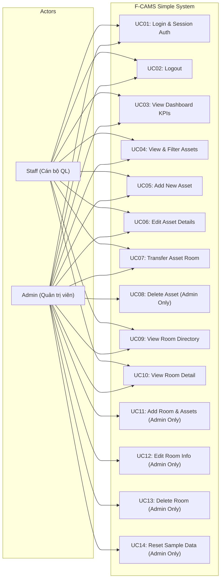
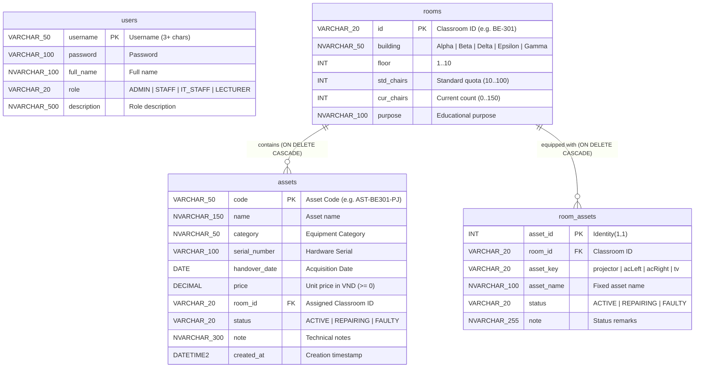

# TRƯỜNG ĐẠI HỌC FPT - FPT UNIVERSITY
## DEPARTMENT OF INFORMATION TECHNOLOGY
### COURSE: PRJ301 - JAVA WEB APPLICATION DEVELOPMENT

---

# Requirement & Design Specification
## FPT Classroom Asset Management System (F-CAMS Simple)

**Version:** 1.0  
**Group:** FCAMS Project Team  
**Class:** PRJ301 - SE / IA  
**Date:** October 2026  

| No | Student ID | Full Name | Contribution (%) |
| :---: | :---: | :--- | :---: |
| 1 | HE190001 | Trần Văn Tuấn | 40% |
| 2 | HE190002 | Nguyễn Quốc Hùng | 30% |
| 3 | HE190003 | Lê Hoàng Nam | 30% |

---

## Table of content
- [Table of content](#table-of-content)
- [I. Overview](#i-overview)
  - [1. User Requirements](#1-user-requirements)
    - [1.1 Actors](#11-actors)
    - [1.2 Use Cases](#12-use-cases)
      - [a. Diagram(s)](#a-diagrams)
      - [b. Descriptions](#b-descriptions)
  - [2. Overall Functionalities](#2-overall-functionalities)
    - [2.1 Screens Flow](#21-screens-flow)
    - [2.2 Screen Descriptions](#22-screen-descriptions)
    - [2.3 Screen Authorization](#23-screen-authorization)
    - [2.4 Database Design](#24-database-design)
      - [a. Database Schema](#a-database-schema)
      - [b. Table Descriptions](#b-table-descriptions)
- [II. Design Specifications](#ii-design-specifications)
  - [1. Login Screen](#1-login-screen)
    - [1.1 Web Controller / Service](#11-web-controller--service)
    - [1.2 Web Application: Screen UI & Field Details](#12-web-application-screen-ui--field-details)
  - [2. Dashboard Screen (Bảng điều khiển Thống kê)](#2-dashboard-screen-bảng-điều-khiển-thống-kê)
    - [2.1 Web Controller / Service](#21-web-controller--service)
    - [2.2 Web Application: Screen UI & Field Details](#22-web-application-screen-ui--field-details)
  - [3. Asset Management Screen (Quản lý Tài sản - CRUD)](#3-asset-management-screen-quản-lý-tài-sản---crud)
    - [3.1 Web Controller / Service](#31-web-controller--service)
    - [3.2 Web Application: Screen UI & Field Details](#32-web-application-screen-ui--field-details)
  - [4. Room Management Screen (Quản lý Phòng học - CRUD)](#4-room-management-screen-quản-lý-phòng-học---crud)
    - [4.1 Web Controller / Service](#41-web-controller--service)
    - [4.2 Web Application: Screen UI & Field Details](#42-web-application-screen-ui--field-details)
  - [5. Room Detail Screen (Chi tiết Phòng học & Thiết bị)](#5-room-detail-screen-chi-tiết-phòng-học--thiết-bị)
    - [5.1 Web Controller / Service](#51-web-controller--service)
    - [5.2 Web Application: Screen UI & Field Details](#52-web-application-screen-ui--field-details)

---

# I. Overview
The **FPT Classroom Asset Management System (F-CAMS Simple)** is a specialized Java Web application project engineered for classroom asset, equipment, and facility management at FPT University Hoa Lac campus. The project is developed using **Java 17 LTS, Jakarta EE 10 (Servlet 6.0, JSP, JSTL 2.0, Custom JSP Tag Library)**, running on **Apache Tomcat 10.1** web container, and data persistence is managed by **Microsoft SQL Server 2022** database via Microsoft JDBC Driver.

The primary objective of F-CAMS Simple is to streamline the operations of campus administrators and IT facility officers in monitoring classroom capacity, tracking asset lifecycle (projectors, air conditioners, Smart TVs, sound systems, lab workstations), overseeing maintenance status, and preventing asset loss during room reallocations across campus blocks (`Alpha`, `Beta`, `Delta`, `Epsilon`, `Gamma`).

---

## 1. User Requirements

### 1.1 Actors

| # | Actor | Description |
| :---: | :--- | :--- |
| **1** | **Admin** | System Administrator possessing full management authority across the entire platform. Has complete CRUD privileges on assets (Add, Edit, Relocate, and **DELETE**), full management privileges on rooms (Add room with default assets, Edit specifications, and **DELETE** room), dashboard statistical viewing, and system data reset authority. |
| **2** | **Staff** | Operational Staff / IT Support Officer responsible for daily classroom inspection and equipment handling. Has permissions to view Dashboard KPIs, manage assets (search, filter, add new asset, edit asset info, transfer assets between rooms), and inspect detailed room equipment catalogs. Explicitly **RESTRICTED** from dangerous operations (cannot delete assets, cannot add, edit, or delete classroom profiles). |

---

### 1.2 Use Cases

#### a. Diagram(s)



---

#### b. Descriptions

| ID | Feature | Use Case | Use Case Description |
| :---: | :--- | :--- | :--- |
| **01** | Authentication | Login | Users provide username and password to authenticate into the system; stores User object in HttpSession. |
| **02** | Authentication | Logout | Clears the active HttpSession and redirects user back to the login screen. |
| **03** | Dashboard | View Overall KPIs | Displays summary KPI metric cards: Total Assets, Total Rooms, and Total Estimated Inventory Valuation in VND. |
| **04** | Dashboard | View Status Distribution | Analyzes the operational proportion of assets (Active, Maintenance/Repairing, Faulty/Broken) in percentages. |
| **05** | Dashboard | View Recent & Urgent Lists | Displays the top 5 most recently acquired assets and an urgent alert list of damaged/repairing equipment. |
| **06** | Asset Management | Search & Filter Assets | Multi-criteria asset filtering by Room, Equipment Category, Status, and keyword search (code, name, serial). |
| **07** | Asset Management | Add Asset | Registers a new asset into database with Code, Name, Category, Serial, Handover Date, Price, Room, and Status. |
| **08** | Asset Management | Edit Asset | Updates asset specifications, serial number, unit price, operational status, and maintenance remarks. |
| **09** | Asset Management | Transfer Asset | Relocates an asset to another room and automatically records historical movement notes. |
| **10** | Asset Management | Delete Asset | Permanently deletes an asset record from database. Restricted to Admin only; enforced by AuthFilter. |
| **11** | Room Management | View & Filter Rooms | Lists campus rooms with building filter, chair/device issue filter, and keyword search. |
| **12** | Room Management | Add Classroom | Creates a new room record with floor, purpose, and chair quota, auto-initializing 4 core room assets (Admin only). |
| **13** | Room Management | Edit Classroom | Updates classroom parameters including building, floor, standard seats, current seats, and educational purpose (Admin only). |
| **14** | Room Management | Delete Classroom | Deletes a classroom and cascades deletion to all assigned assets and room assets (Admin only). |
| **15** | Room Management | View Room Detail | Displays full classroom details, chair variance indicators, and comprehensive table of all equipped assets. |

---

## 2. Overall Functionalities

### 2.1 Screens Flow

```mermaid
flowchart TD
    Login["Login Screen (/login)"]
    Main["Main Navigation Bar\n(Home | Tài sản | Phòng học | Logout)"]
    Logout["Logout (/logout)"]
    Dash["Dashboard Screen (/dashboard)"]
    Assets["Asset Management Screen (/assets)"]
    Rooms["Room Management Screen (/rooms)"]
    RoomDetail["Room Detail Screen (/room-detail)"]

    AddAsset["Add Asset Form Box"]
    EditAsset["Edit Asset Form Box"]
    TransferAsset["Transfer Asset Form Box"]
    DeleteAsset["Delete Asset Action (Admin)"]

    AddRoom["Add Room Form (Admin)"]
    EditRoom["Edit Room Form (Admin)"]
    DeleteRoom["Delete Room Action (Admin)"]

    Login -->|Authenticated| Main
    Main --> Logout
    Logout --> Login
    Main --> Dash
    Main --> Assets
    Main --> Rooms

    Assets --> AddAsset
    Assets --> EditAsset
    Assets --> TransferAsset
    Assets --> DeleteAsset
    Assets -->|Click Room ID| RoomDetail

    Rooms --> AddRoom
    Rooms --> EditRoom
    Rooms --> DeleteRoom
    Rooms -->|Click Room ID / [Chi tiết]| RoomDetail

    RoomDetail -->|Click [Tài sản]| Assets
    RoomDetail -->|Back link| Rooms
```

---

### 2.2 Screen Descriptions

| # | Feature | Screen | Description |
| :---: | :--- | :--- | :--- |
| **1** | Authentication | Login Screen | Provides username and password entry form with validation alerts and role authentication. |
| **2** | Common UI | Header Navigation | Displays current user credentials, RoleName custom tag, global navbar tabs, and alert message banners. |
| **3** | Dashboard | Dashboard Screen | Presents overall KPI cards (assets, rooms, valuation), asset operational health distribution table, recent additions, and urgent maintenance lists. |
| **4** | Asset Management | Asset Management Screen | Centralized inventory control screen with multi-select filter toolbar, search bar, Add/Edit/Transfer forms, and tabular asset data. |
| **5** | Room Management | Room Management Screen | Classroom directory showing building, floor, chair variance (ChairStatus custom tag), core equipment indicators, and Add/Edit/Delete room controls. |
| **6** | Room Detail | Room Detail Screen | Detailed classroom profile showing capacity specs, educational purpose, and complete listing of all physical assets stationed in the room. |

---

### 2.3 Screen Authorization

| # | Screen / Action | Admin | Staff | Unauthenticated Guest |
| :---: | :--- | :---: | :---: | :---: |
| **1** | Login Screen (`/login`) | **X** | **X** | **X** |
| **2** | Logout (`/logout`) | **X** | **X** | |
| **3** | Dashboard Screen (`/dashboard`) | **X** | **X** | *(Redirects to Login)* |
| **4** | Asset Management - View & Filter (`/assets`) | **X** | **X** | *(Redirects to Login)* |
| **5** | Asset Management - Add / Edit / Transfer Asset | **X** | **X** | *(Redirects to Login)* |
| **6** | **Asset Management - DELETE Asset (Dangerous)** | **X** | | *(Redirects to Login)* |
| **7** | Room Management - View & Filter Rooms (`/rooms`) | **X** | **X** | *(Redirects to Login)* |
| **8** | **Room Management - Add / Edit / DELETE Room (Dangerous)** | **X** | | *(Redirects to Login)* |
| **9** | Room Detail Screen (`/room-detail`) | **X** | **X** | *(Redirects to Login)* |

---

### 2.4 Database Design

#### a. Database Schema



---

#### b. Table Descriptions

| No | Table | Description | Keys & Constraints |
| :---: | :--- | :--- | :--- |
| **01** | `users` | Stores system account credentials, full names, authorization roles (`ADMIN`, `STAFF`, `IT_STAFF`, `LECTURER`), and role descriptions. | **Primary Key:** `username`<br>**Check:** `role IN ('ADMIN', 'STAFF', 'IT_STAFF', 'LECTURER')`<br>**Check:** `LEN(username) >= 3` |
| **02** | `rooms` | Manages campus classroom spaces, physical building locations, floor numbers, standard seat quotas, current seats, and intended educational purposes. | **Primary Key:** `id`<br>**Check:** `building IN ('Alpha', 'Beta', 'Delta', 'Epsilon', 'Gamma')`<br>**Check:** `floor BETWEEN 1 AND 10`<br>**Check:** `std_chairs BETWEEN 10 AND 100`, `cur_chairs BETWEEN 0 AND 150` |
| **03** | `assets` | Comprehensive inventory registry holding all physical classroom assets, categories, manufacturer serial numbers, acquisition date, unit price, assigned room, and health status. | **Primary Key:** `code`<br>**Foreign Key:** `room_id` references `rooms(id)` `ON DELETE CASCADE ON UPDATE CASCADE`<br>**Check:** `status IN ('ACTIVE', 'MAINTENANCE', 'BROKEN', 'REPAIRING', 'FAULTY')`<br>**Check:** `price >= 0` |
| **04** | `room_assets` | Tracks 4 fixed core technical installations per classroom (projector, acLeft, acRight, tv) for quick facility health monitoring. | **Primary Key:** `asset_id` (IDENTITY)<br>**Foreign Key:** `room_id` references `rooms(id)` `ON DELETE CASCADE`<br>**Unique:** `(room_id, asset_key)`<br>**Check:** `asset_key IN ('projector', 'acLeft', 'acRight', 'tv')` |

---

# II. Design Specifications

## 1. Login Screen
Staff and Administrator log in with their designated credentials to access the management portal.

```
+-------------------------------------------------------------------------+
|  Login Page - F-CAMS Simple                                             |
|                                                                         |
|  <h1>Login Page</h1>                                                    |
|  +-------------------------------------------------------------------+  |
|  | [Alert Box: Invalid Username or Password - if authentication fails]|  |
|  +-------------------------------------------------------------------+  |
|                                                                         |
|  Username: [ Staff1 / admin          ]                                  |
|  Password: [ *******                 ]                                  |
|                                                                         |
|  [ Login Button ]   [ Reset Button ]                                    |
|                                                                         |
|  Need a new account? Register here                                      |
|  Click here to get more knowledge                                       |
+-------------------------------------------------------------------------+
```

### 1.1 Web Controller / Service
- **Servlet Class:** `controller.LoginServlet` (URL: `/login`, Methods: `GET`, `POST`)
- **Security Filter:** `filter.AuthFilter` (URL Pattern: `/*` — intercepts unauthenticated sessions and redirects to `/login`)
- **Session Management:** Stores authenticated User bean into `HttpSession` (`sessionScope.currentUser`). Session timeout: **60 minutes** (configured in `web.xml`).
- **Fallback Mechanism:** `dal.UserDAO` includes embedded fallback records if SQL Server is temporarily unavailable during offline testing.

### 1.2 Web Application: Screen UI & Field Details

| Field Name | Field Type | Description |
| :--- | :--- | :--- |
| **Username** | Text Box (Required) | User enters their account username (min 3 characters, e.g. `admin`, `it_beta`, `hungnq`). |
| **Password** | Password Box (Required) | User enters their secret authentication password (e.g. `123`). |
| **Login** | Submit Button | Sends HTTP POST request to `/login` to authenticate credentials against `dbo.users`. |
| **Reset** | Reset Button | Clears all currently entered values in username and password input fields. |

---

## 2. Dashboard Screen (Bảng điều khiển Thống kê)
Displays comprehensive high-level system indicators, asset operational health ratios, recently added equipment, and urgent maintenance alerts.

```
+-------------------------------------------------------------------------+
| Xin chào, Quản trị viên Hệ thống (Quản trị viên (Admin)) | Đăng xuất    |
| [ Home ] | [ Tài sản ] | [ Phòng học ]                                  |
|=========================================================================|
| Bảng điều khiển Thống kê (Dashboard)                                    |
|                                                                         |
| [ TỔNG SỐ TÀI SẢN ]       [ TỔNG SỐ PHÒNG HỌC ]   [ GIÁ TRỊ TÀI SẢN ]   |
|       43 thiết bị               9 phòng              957,000,000 VNĐ    |
|                                                                         |
| Tỷ lệ tình trạng tài sản toàn hệ thống:                                |
| - Đang hoạt động tốt (ACTIVE)     : 38 (88.4%)                          |
| - Đang bảo trì / sửa (REPAIRING)  : 3  (7.0%)                           |
| - Hỏng hóc / Thay thế (FAULTY)    : 2  (4.7%)                           |
|                                                                         |
| [Tài sản mới ghi nhận gần đây]      [Tài sản cần bảo trì khẩn cấp]      |
| - AST-AL102-WS2: Apple iMac M3      - AST-EP201-TV: Cháy cổng HDMI      |
| - AST-AL102-WS1: HP Z2 G9 i9        - AST-AL201-AC2: Rò rỉ nước ngưng   |
+-------------------------------------------------------------------------+
```

### 2.1 Web Controller / Service
- **Servlet Class:** `controller.DashboardServlet` (URL: `/dashboard`, Method: `GET`)
- **Data Retrieval:** `dal.AssetDAO.getDashboardStats(totalRooms)` queries summary aggregates, top 5 recent assets, and broken/repairing assets.
- **DTO Model:** `model.DashboardStats` carries calculated KPIs, currency formatters (`###,###,### VNĐ`), and percentage rates to `/dashboard.jsp`.

### 2.2 Web Application: Screen UI & Field Details

| Element / Field Name | Element Type | Description |
| :--- | :--- | :--- |
| **Total Assets Card** | Metric Box (Read-only) | Displays total count of all inventory assets recorded in database. |
| **Total Rooms Card** | Metric Box (Read-only) | Displays total number of active classrooms across all campus buildings. |
| **Estimated Value Card** | Metric Box (Read-only) | Displays total procurement price sum of all assets, formatted in VND (`###,###,### VNĐ`). |
| **Asset Health Table** | Data Table | Breaks down assets into Active, Repairing, and Faulty counts with calculated percentage ratios. |
| **Recent Assets List** | Data Table | Displays top 5 newly registered items with asset code, name, category, room, and unit price. |
| **Urgent Assets List** | Data Table | Displays urgent maintenance tickets for equipment in `FAULTY` or `REPAIRING` state. |

---

## 3. Asset Management Screen (Quản lý Tài sản - CRUD)
Central management portal for classroom inventory: multi-criteria search and filter, asset registration, asset detail update, inter-room transfer, and deletion.

```
+-------------------------------------------------------------------------+
| Quản lý Tài sản (Asset Management - CRUD)                               |
|                                                                         |
| [Phòng: Tất cả v] [Danh mục: Tất cả v] [Trạng thái: Tất cả v]          |
| [Tìm kiếm: Mã, tên, serial...   ] [ Tìm kiếm ] [ Tất cả ]              |
|                                                                         |
| Tìm thấy 43 tài sản phù hợp.  --  [+ Ghi nhận tài sản mới]              |
|                                                                         |
| +---------------------------------------------------------------------+ |
| | FORM: Ghi nhận / Cập nhật / Chuyển phòng (Toggleable Fieldset)      | |
| | Mã tài sản (*): [ AST-BE303-PJ ]  Tên (*): [ Máy chiếu Sony Laser ] | |
| | Danh mục: [ Máy chiếu v]  Serial: [ SN-SNY-99 ]  Đơn giá: [25000000]| |
| | Phòng bố trí: [ BE-303 v]  Trạng thái: [ Hoạt động tốt v]           | |
| | [ Lưu tài sản mới ]  [ Hủy ]                                        | |
| +---------------------------------------------------------------------+ |
|                                                                         |
| No | Mã TS       | Tên tài sản        | Serial    | Phòng  | Trạng thái | Thao tác     |
| 1  | AST-BE301-PJ| Máy chiếu Sony 4K  | SN-SNY-01 | BE-301 | Tốt        | [Sửa][Chuyển]|
| 2  | AST-BE301-AC| Điều hòa Daikin 18k| SN-DKN-01 | BE-301 | Tốt        | [Sửa][Xóa]*  |
+-------------------------------------------------------------------------+
```

### 3.1 Web Controller / Service
- **Servlet Class:** `controller.AssetServlet` (URL: `/assets`, Methods: `GET`, `POST`)
- **Actions Handled:**
  - `GET`: Evaluates `roomId`, `category`, `status`, `keyword` filters; loads `editCode` or `transferCode` if requested.
  - `POST action=create`: Adds new asset to `dbo.assets` after validating code uniqueness and required fields.
  - `POST action=update`: Modifies asset name, category, serial, price, room, status, and notes.
  - `POST action=transfer`: Moves asset to `targetRoom` and appends transfer audit log into note column.
  - `POST action=delete`: Removes asset record (**ADMIN ONLY**; Staff is blocked at both Servlet and Filter level).

### 3.2 Web Application: Screen UI & Field Details

| Field Name | Field Type | Description |
| :--- | :--- | :--- |
| **Room Filter** | Dropdown List | Filters asset records by assigned classroom (or ALL). |
| **Category Filter** | Dropdown List | Filters assets by equipment type (`Máy chiếu`, `Điều hòa`, `Smart TV`, `Âm thanh`, `Thiết bị Lab`, `Bàn ghế`, `Khác`). |
| **Status Filter** | Dropdown List | Filters assets by operational health: `ACTIVE` (Tốt), `REPAIRING` (Bảo trì), `FAULTY` (Hỏng). |
| **Keyword Input** | Text Box | Searches matches in asset code, asset name, or manufacturer serial number. |
| **Mã tài sản (code)** | Text Box (Required) | Unique asset code identifier (min 3 characters, e.g. `AST-BE301-PJ`). Primary key. |
| **Tên tài sản (name)** | Text Box (Required) | Descriptive asset name including brand and specifications. |
| **Số serial** | Text Box (Optional) | Manufacturer hardware serial number for physical asset verification. |
| **Đơn giá (price)** | Number Box (VND) | Procurement unit cost in VND ($\ge 0$). |
| **Phòng bố trí (roomId)** | Dropdown List | Target classroom where the asset is physically deployed. |
| **Thao tác (Actions)** | Hyperlinks / Buttons | `[Sửa]` opens inline edit form; `[Chuyển phòng]` opens relocation form; `[Xóa]` triggers deletion (Admin only). |

---

## 4. Room Management Screen (Quản lý Phòng học - CRUD)
Directory of campus classrooms with capacity tracking, chair discrepancy detection via custom tag, and complete room management.

```
+-------------------------------------------------------------------------+
| Quản lý Phòng học (Room Management - CRUD)                              |
|                                                                         |
| [Tòa: Tất cả v]  [Trạng thái: Tất cả v]  [Tìm: Mã, mục đích...] [Tìm]   |
| Hiển thị 9 phòng (Tổng số: 9 phòng). -- [+ Thêm phòng học mới (Admin)]  |
|                                                                         |
| +---------------------------------------------------------------------+ |
| | FORM: Thêm / Sửa phòng học (Chỉ Admin)                              | |
| | Mã phòng (*): [ BE-303 ]  Tòa nhà: [ Beta v]  Tầng: [ 3 ]           | |
| | Mục đích: [ Lý thuyết tiêu chuẩn v]  Ghế chuẩn: [35]  Hiện có: [35] | |
| | Máy chiếu: [ Máy chiếu Sony Laser ]  Điều hòa: [ Daikin 18k ]       | |
| | [ Lưu phòng học mới ]  [ Hủy ]                                      | |
| +---------------------------------------------------------------------+ |
|                                                                         |
| No | Mã phòng | Tòa nhà | Tầng | Mục đích sử dụng | Chỗ ngồi  | Tài sản | Thao tác   |
| 1  | BE-301   | Beta    | 3    | Lý thuyết chuẩn  | 35/35(Đủ) | 5 TS    | [Chi tiết] |
| 2  | AL-201   | Alpha   | 2    | Lab CNTT         | 30/35(T5) | 4 TS    | [Sửa][Xóa]*|
+-------------------------------------------------------------------------+
```

### 4.1 Web Controller / Service
- **Servlet Class:** `controller.RoomServlet` (URL: `/rooms`, Methods: `GET`, `POST`)
- **Authorization Gate:** `create`, `update`, and `delete` actions are restricted strictly to **ADMIN** role.
- **Database Transaction:** Room creation uses `connection.setAutoCommit(false)` to atomically insert room specs, 4 core `room_assets`, and 4 detailed `assets`.
- **Custom Tags:** `<fcams:chairStatus cur="..." std="..."/>` renders seat variance: `30/35 (Thiếu 5)` or `35/35 (Đủ)`.

### 4.2 Web Application: Screen UI & Field Details

| Field Name | Field Type | Description |
| :--- | :--- | :--- |
| **Building Filter** | Dropdown List | Filters rooms by campus block (`Alpha`, `Beta`, `Delta`, `Epsilon`, `Gamma`, or ALL). |
| **Status Filter** | Dropdown List | Filters rooms by condition: `ISSUES` (seat shortage or broken gear) or `OK`. |
| **Mã phòng (id)** | Text Box (Required) | Room code formatted strictly to regex `^[A-Z]{2}-\d{3}$` (e.g. `BE-303`, `AL-101`). |
| **Tầng (floor)** | Number Box (1 - 10) | Floor level in building where the classroom is situated. |
| **Mục đích (purpose)** | Dropdown / Text Box | Educational category: `Lý thuyết tiêu chuẩn`, `Phòng Lab CNTT`, `Phòng Seminar`, `Hội trường`. |
| **Định mức ghế (std)** | Number Box (10 - 100) | Official standard seating capacity established for the classroom. |
| **Ghế hiện có (cur)** | Number Box (0 - 150) | Actual physical chair count observed during latest inspection. |

---

## 5. Room Detail Screen (Chi tiết Phòng học & Thiết bị)
Dedicated room inspection screen displaying complete room specifications, seating quota status, and a full catalog of all assets deployed in the room.

```
+-------------------------------------------------------------------------+
| << Quay lại Danh mục phòng học | Xem trên trang Quản lý Tài sản >>      |
|                                                                         |
| Chi tiết Phòng học: BE-301 (Tòa Beta -- Tầng 3)                         |
|                                                                         |
| Thông tin phòng học:                                                    |
| * Mục đích sử dụng: Lý thuyết tiêu chuẩn                                |
| * Sức chứa / Chỗ ngồi: 35/35 (Đủ)                                       |
| * Tổng số tài sản đang trang bị: 5 tài sản  [Sửa thông tin phòng]*      |
|                                                                         |
| Toàn bộ tài sản và trang thiết bị hiện đang trang bị trong phòng BE-301:|
| [+ Thêm tài sản mới vào phòng BE-301]                                   |
|                                                                         |
| No | Mã tài sản    | Tên tài sản & Mô tả    | Serial    | Đơn giá    | Tình trạng | Thao tác   |
| 1  | AST-BE301-PJ  | Máy chiếu Sony 4K      | SN-SNY-01 | 25,000,000 | Tốt        | [Sửa][Chuyển]|
| 2  | AST-BE301-AC1 | Điều hòa Daikin 18k(L) | SN-DKN-01 | 14,500,000 | Tốt        | [Sửa][Chuyển]|
| 3  | AST-BE301-TV  | Smart TV Samsung 65"   | SN-SSG-01 | 16,200,000 | Tốt        | [Sửa][Chuyển]|
+-------------------------------------------------------------------------+
```

### 5.1 Web Controller / Service
- **Servlet Class:** `controller.RoomDetailServlet` (URL: `/room-detail?id=...`, Method: `GET`)
- **Data Retrieval:** `dal.RoomDAO.getRoomById(id)` populates Room entity and its associated Asset list (`dal.AssetDAO.getAssetsByRoom`).

### 5.2 Web Application: Screen UI & Field Details

| Element / Field Name | Element Type | Description |
| :--- | :--- | :--- |
| **Room Profile Summary Card** | Information Card | Displays Room ID, Building, Floor, Educational Purpose, and Chair Variance indicator. |
| **Equipped Asset Catalog Table** | Data Table | Renders tabular list of all assets deployed in this room, complete with code, name, category, serial, price, status, and notes. |
| **Link: Add Asset to Room** | Hyperlink | Navigates directly to `/assets?roomId=...` with target room pre-selected in registration form. |
| **Link: Edit Room Profile** | Hyperlink (Admin only) | Navigates to `/rooms?editId=...` allowing Admin to modify room dimensions. |
| **Item Actions** | Action Links / Buttons | Allows inline editing `[Sửa]`, transfer to another room `[Chuyển]`, or deletion `[Xóa]` (Admin only). |
